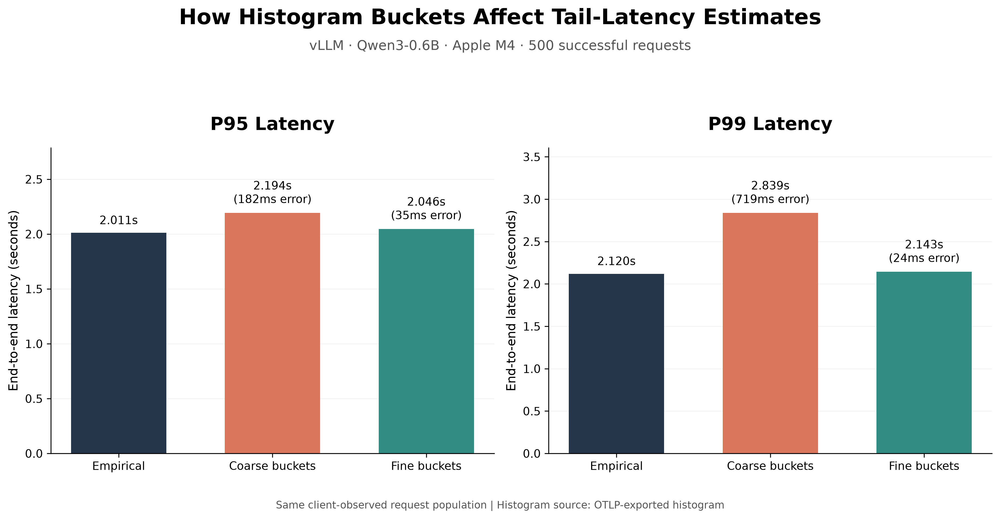
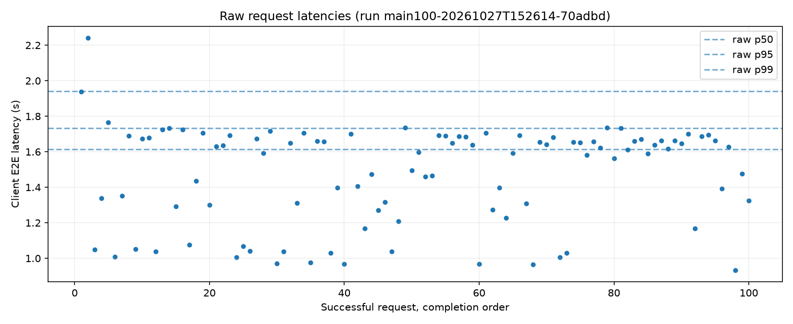

# vLLM Inference Observability Lab

**Investigating the accuracy of p95/p99 inference latency measurements using vLLM, OpenTelemetry, and Prometheus.**

This project started with a practical question: **How much information is lost when we measure LLM inference latency using histogram buckets instead of individual request timings?**

I built a local inference and observability pipeline around **Qwen3-0.6B on vLLM**, collected per-request latency measurements and histograms through **OpenTelemetry Protocol (OTLP)**, and compared empirical p50/p95/p99 values against histogram-based estimates. The repository also includes inference benchmarking, a preliminary instrumentation-overhead experiment, and a snapshot of vLLM's exported metrics.

## Key finding

In a controlled **500-request** run, increasing the client-side histogram resolution from **13 to 90 bucket boundaries** reduced **p99 estimation error from approximately 719 ms to 24 ms** — a **96.7% reduction**.

**Inference did not get faster. The measurement became more accurate.** This distinction matters for tail-latency dashboards, performance alerts, SLOs, and capacity planning.



## Architecture

Two telemetry pipelines run alongside the inference server:

```text
                          Qwen3-0.6B / vLLM (:8000)
                            /                  \
                   /metrics (pull)        Inference requests
                          |                     |
               OTel Collector           Python benchmark client
             Prometheus receiver      Per-request E2E latency + TTFT
                          |                     |
               Prometheus exporter             OTel SDK
                     (:8889)          Request spans + two histograms
                          |                     |
                   Prometheus             OTLP/HTTP push
                     (:9090)                    |
                                         OTel Collector (:14318)
                                                 |
                                           Local JSONL files
                                                 |
                                         Python / NumPy analysis
```

The client also writes individual request latencies to CSV. These recorded values provide the **empirical reference** against which the histogram estimates are evaluated.

**Measurement scope:** The coarse/fine experiment compares *custom client-side OpenTelemetry histograms* built from the **same successful client requests**. vLLM's native `/metrics` histogram is captured separately. Client-observed E2E and server-side E2E are not identical timing definitions and are **not** compared as if they were the same ground truth.

## Experiments

### 1. How much do histogram buckets distort p95 and p99?

I ran controlled workloads of **100 and 500 successful requests**, using concurrency **2** and a maximum of **64 output tokens** per request.

- **Reference:** `numpy.percentile` on individual successful request E2E latencies (linear interpolation).
- **Coarse:** 13 histogram bucket boundaries.
- **Fine:** 90 histogram bucket boundaries.
- **Estimate:** Quantile interpolation from histogram counts exported through OTLP.

| Requests | Percentile | Empirical | Coarse estimate | Fine estimate | Coarse error | Fine error |
|---:|:---:|---:|---:|---:|---:|---:|
| 100 | p50 | 1.6145 s | 1.4731 s | 1.5652 s | 141.4 ms | 49.3 ms |
| 100 | p95 | 1.7336 s | 1.9570 s | 1.7910 s | 223.3 ms | 57.4 ms |
| 100 | p99 | 1.9414 s | 2.0000 s | 1.9685 s | 58.6 ms | 27.1 ms |
| 500 | p50 | 1.7275 s | 1.5330 s | 1.7058 s | 194.4 ms | 21.7 ms |
| 500 | p95 | 2.0111 s | 2.1935 s | 2.0462 s | 182.5 ms | 35.2 ms |
| 500 | p99 | 2.1197 s | 2.8387 s | 2.1435 s | **719.0 ms** | **23.8 ms** |

In the 500-request experiment, the coarse histogram overestimated p99 by nearly **0.72 seconds**. The finer histogram provided a substantially closer approximation. The effect was also present in the 100-request run, although its magnitude varied with the workload distribution.

This is not a claim that 90 boundaries are universally optimal: greater histogram resolution can require more time-series storage, while the most useful bucket placement depends on the application's latency distribution and SLO thresholds.

**Data:** [100-request comparison](results/main100-20261027T152614-70adbd_percentile_comparison.csv) · [500-request comparison](results/main500-20261027T153310-302fd0_percentile_comparison.csv)



### 2. Does client-side instrumentation add overhead?

I compared **30 requests without client OpenTelemetry** and **30 requests with OTel spans and histogram recording enabled**. Both runs completed successfully.

| Metric | Without client OTel | With client OTel |
|---|---:|---:|
| Completed requests | 30/30 | 30/30 |
| Mean E2E latency | 1.426 s | 1.638 s |
| p95 E2E latency | 1.723 s | 1.801 s |
| Wall-clock run time | 22.25 s | 25.70 s |

The instrumented run showed **14.9% higher mean E2E latency**, but this is only an **initial local observation**. These were two sequential, small runs; caching, thermal state, queueing, and other run-to-run variation could explain some or all of the difference. This experiment **does not establish a causal 15% OTel overhead**. A repeated, counterbalanced study is needed.

**Data:** [Without OTel](results/without_client_otel-20261027T152816-90144e_observations.csv) · [With OTel](results/with_client_otel-20261027T152838-2e4d52_observations.csv)

### 3. Which metrics does vLLM export?

I captured a metrics schema from a local server reporting **vLLM 0.31.0+cpu**:

- **82** exposed metric families, including HTTP/Python instrumentation and generated `_created` series.
- **37** vLLM-specific families after excluding `_created`.
- **8** latency/time histograms, including E2E latency, TTFT, inter-token latency, queueing, prefill, decode, inference time, and time per output token.

For example, the server's native E2E histogram has boundaries at **2.0 s and 2.5 s**, so requests with durations of 2.12 s and 2.40 s fall into the same interval. Interpolation from those counts cannot recover their exact individual latencies.

**Artifacts:** [Schema snapshot](results/schema_0.31.0_cpu.json) · [Prometheus metrics snapshot](results/server_metrics_0.31.0_cpu.prom)

**Version-comparison status:** This repository contains a baseline schema for one server version, **not yet a reproducible cross-version diff**. A follow-up is to compare metric names, types, labels, and bucket boundaries across vLLM releases.

## Repository guide

| Path | Description |
|---|---|
| [`ParallelIQ_OTel_Percentiles_Lab.ipynb`](ParallelIQ_OTel_Percentiles_Lab.ipynb) | Main experiment: request-level OTLP data, 100/500-request comparisons, overhead probe, server snapshots, report generation |
| [`vllm_qwen_m4_benchmark_optimization_otlp_lab.ipynb`](vllm_qwen_m4_benchmark_optimization_otlp_lab.ipynb) | Streaming TTFT/TPOT/E2E measurement, throughput and concurrency tests, first OTLP tracing pipeline |
| [`vllm_prometheus_live_lab.ipynb`](vllm_prometheus_live_lab.ipynb) | Live Prometheus queries, inference-load testing, metrics visualization |
| [`results/`](results/) | Request measurements, percentile comparisons, OTLP exports, charts, server metrics, and run summaries |

## Running the lab

Experiments were carried out locally on an **Apple M4 Mac**, with **Qwen/Qwen3-0.6B** served through a working vLLM/Metal setup. Your backend and vLLM installation may differ from the original environment.

**Prerequisites:**

1. An OpenAI-compatible vLLM server reachable at `http://127.0.0.1:8000`, exposing `/v1/models`, `/v1/chat/completions`, and `/metrics`.
2. A Prometheus-scraping OTel Collector exposing metrics at `127.0.0.1:8889`, and Prometheus at `127.0.0.1:9090` for the historical metrics notebooks.
3. For the primary percentile notebook, a separate **OTLP/HTTP Collector receiver on `127.0.0.1:14318`**, exporting OTLP metrics and traces to local JSONL files.
4. A notebook Python environment with NumPy, pandas, Matplotlib, JupyterLab, and the OpenTelemetry Python SDK/exporters.

Clone the repository and prepare the notebook environment:

```bash
git clone https://github.com/pranavpradhan007/vllm-otel-observability-lab.git
cd vllm-otel-observability-lab

python3 -m venv .venv-notebook
source .venv-notebook/bin/activate
python -m pip install jupyterlab numpy pandas matplotlib \
  opentelemetry-sdk opentelemetry-exporter-otlp-proto-http

jupyter lab
```

Launch vLLM in a **separate, compatible server environment**. An example of the original server settings:

```bash
vllm serve Qwen/Qwen3-0.6B \
  --host 127.0.0.1 \
  --gpu-memory-utilization 0.5 \
  --max-model-len 1024 \
  --max-num-seqs 2
```

Open [`ParallelIQ_OTel_Percentiles_Lab.ipynb`](ParallelIQ_OTel_Percentiles_Lab.ipynb). Check service URLs and run the sections **in order**, beginning with preflight and the six-request pilot.

**Reproducibility note:** The original machine-specific Prometheus and Collector configuration files are **not included** in this repository. The OTLP extension in the benchmarking notebook contains a cell to generate an isolated Collector configuration, but the scrape pipeline needs its own setup. Cloning this repository alone does not start every service.

**Avoid “Run All” without reviewing flags.** The committed notebook may have `RUN_500 = True` and `RUN_OVERHEAD = True`, which trigger additional real inference. Check these flags and the output paths before running.

## Lessons and limitations

Classic histogram quantiles are **approximations**. Their error depends on how buckets are placed and how request latency is distributed. Better buckets can improve p95/p99 estimates, but they do not recover the exact underlying measurements.

**OTLP does not automatically make percentiles exact.** Transporting an aggregated histogram over OTLP still leaves it aggregated; computing empirical quantiles requires access to individual observations or a sufficiently precise alternative representation.

This is an exploratory local study: one machine, one small model, synthetic prompts, limited concurrency, and a preliminary overhead probe. It is **not a production-scale performance benchmark**. Future work includes repetitions across load patterns, overhead/sampling studies, bucket alignment around SLO thresholds, and verified vLLM version-to-version schema comparisons.

---

Built by [Pranav Pradhan](https://github.com/pranavpradhan007) using Python, vLLM, OpenTelemetry, OTLP, and Prometheus.
